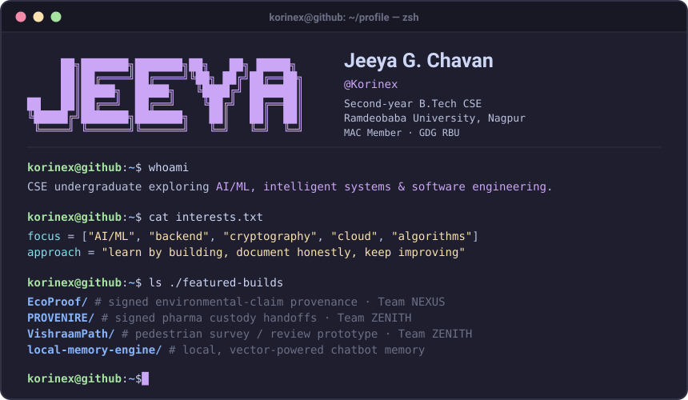
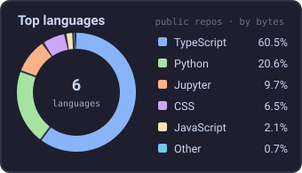

  <!-- The Fuad-style block ASCII name is INSIDE this terminal image. -->
  

   

  <!-- Animated typing line -->
  

   

  
  &nbsp;
  

 

## &nbsp;&nbsp;About me

Hi, I'm **Jeeya G. Chavan**, a **second-year B.Tech Computer Science & Engineering student at Ramdeobaba University, Nagpur**.

I'm interested in **AI/ML, intelligent systems and software engineering**, especially the logic and architecture behind how systems work. I'm currently strengthening my programming fundamentals and exploring these interests through projects and hackathons.

I'm also a **Machine Learning, Android & Cloud (MAC) Member at Google Developer Groups on Campus, Ramdeobaba University (GDG RBU)**. Collaborative projects have taught me to experiment, adapt and learn from others.

I like learning by building, documenting what I learn, and being clear about what works and what still needs improvement.

### What I'm exploring

- AI/ML, NLP and intelligent systems
- Backend engineering and data management
- Cryptography, data integrity and system reliability
- Cloud technologies and distributed systems
- Algorithms, problem-solving and software engineering

---

## &nbsp;&nbsp;Tech stack

<table>
  <tr>
    <th align="left">Category</th>
    <th align="left">Tools I work with</th>
  </tr>
  <tr>
    <td><b>Languages</b></td>
    <td>
      
      
      
    </td>
  </tr>
  <tr>
    <td><b>Frontend</b></td>
    <td>
      
      
      
      
    </td>
  </tr>
  <tr>
    <td><b>Backend & data</b></td>
    <td>
      
      
      
      
      
      
      
    </td>
  </tr>
  <tr>
    <td><b>Workflow</b></td>
    <td>
      
      
      
      
      
    </td>
  </tr>
</table>

---

## &nbsp;&nbsp;Featured projects

| Project | What it does | Stack | Links |
| :--- | :--- | :--- | :--- |
| **EcoProof** | Team NEXUS hackathon prototype for signed environmental-claim provenance, version chains and replica verification. | React · TypeScript · Express · SQLite | [Repository ↗](https://github.com/Korinex/CF26-ES01-Nexus) |
| **PROVENIRE** | Team ZENITH hackathon prototype for signed, receiver-confirmed pharmaceutical custody handoffs. | React · TypeScript · Express · SQLite | [Repository ↗](https://github.com/Korinex/PROVENIRE) |
| **VishraamPath** | Team ZENITH pedestrian survey / review workflow using illustrative demo data. | React · FastAPI · Leaflet · SQLite | [Repository ↗](https://github.com/Korinex/VISHRAMPATH) · [Live demo ↗](https://vishrampath-mhoc.vercel.app/) |
| **Local Memory Engine** | Local chatbot memory with semantic + keyword retrieval, versioned facts, and SQLite persistence. | Python · FastAPI · Sentence Transformers · SQLite | [Repository ↗](https://github.com/Korinex/local-memory-engine) |

<b>More builds & experiments</b>

 

| Project | What it explores | Stack | Links |
| :--- | :--- | :--- | :--- |
| **AQI Explorer** | Historical air-quality lookup, city comparisons, pollutant readings and trend charts. Uses a bundled dataset, not live readings. | Python · FastAPI · Next.js · Pandas | [Repository ↗](https://github.com/Korinex/aqi-explorer) · [Live demo ↗](https://aqi-explorer-2djk.vercel.app/) |
| **Privacy Shield** | Local-first text / image / PDF redaction prototype with fail-closed export checks. | FastAPI · Next.js · TypeScript | [Repository ↗](https://github.com/Korinex/YCCE-HACKATHON) |

---

## &nbsp;&nbsp;Beyond my own repos

- **CASCADE / QUORUM** — contributed the synthetic evidence API and client, wallet-linked proposal flow, and Hardhat tooling updates.  
  [Project ↗](https://github.com/Shifa-rbu/QUORUM) · [Evidence flow PR ↗](https://github.com/Shifa-rbu/QUORUM/pull/6) · [Tooling PR ↗](https://github.com/Shifa-rbu/QUORUM/pull/7)
- **JalRakshak** — contributor to a drought-warning and smart-tanker-management prototype.  
  [Project ↗](https://github.com/25harmaink-dotcom/innovare)

---

## &nbsp;&nbsp;Contribution snake

  <!-- Generated by .github/workflows/snake.yml after the first workflow run -->
  <picture>
    <source media="(prefers-color-scheme: dark)" srcset="https://raw.githubusercontent.com/Korinex/Korinex/output/snake-dark.svg" />
    <source media="(prefers-color-scheme: light)" srcset="https://raw.githubusercontent.com/Korinex/Korinex/output/snake-light.svg" />
    
  </picture>

---

## &nbsp;&nbsp;GitHub activity

  
  &nbsp;&nbsp;
  

---

## &nbsp;&nbsp;Connect with me

  
  &nbsp;
  
  &nbsp;
  
  &nbsp;
  

I'm happy to connect about projects, collaboration, or learning together.

---

Design credits

Profile design inspired by:

- [codyandersan](https://github.com/codyandersan/codyandersan) — terminal-style header and overall visual direction.
- [Fuad-Haque](https://github.com/Fuad-Haque/Fuad-Haque) — block-ASCII styling and animated typing introduction.
- [muhammadadil0](https://github.com/muhammadadil0/muhammadadil0) — section organisation and tech-stack presentation.

Widgets and tools:
- [Readme Typing SVG](https://github.com/DenverCoder1/readme-typing-svg)
- [GitHub Readme Streak Stats](https://github.com/DenverCoder1/github-readme-streak-stats)
- [Contribution Snake](https://github.com/Platane/snk)
- [Shields.io](https://shields.io)

Colour palette: [Catppuccin Mocha](https://github.com/catppuccin/catppuccin).

  <h3>“Stay curious. Build thoughtfully.”</h3>
  
<samp>LEARN &nbsp;·&nbsp; BUILD &nbsp;·&nbsp; REFLECT &nbsp;·&nbsp; REPEAT</samp>

